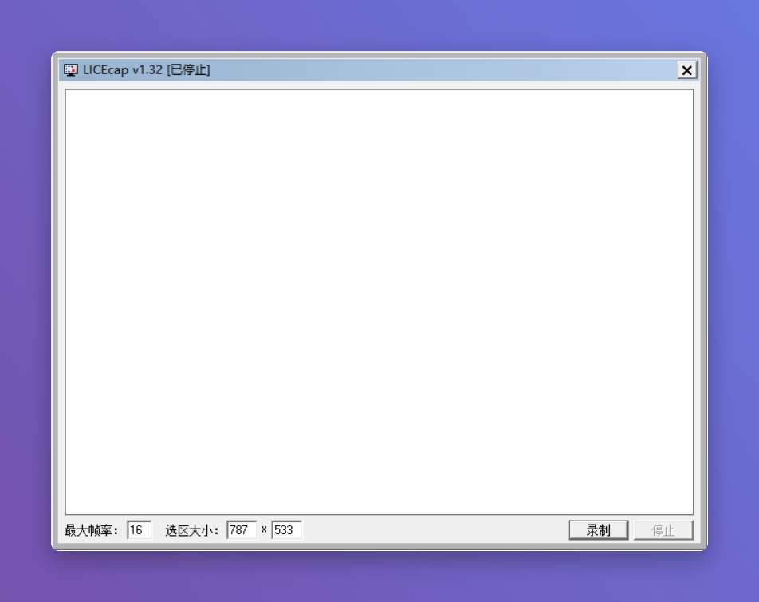

# LICEcap

> 一句话简介：基于知名开源工具 LICEcap 的 GIF 录屏脚本，自由框选屏幕区域录制，一键导出 GIF/APNG 动画，适合录制屏幕演示与操作教程。

---

## 核心特性

- **自由框选录制**：拖动窗口即可圈定任意屏幕区域进行录制
- **内嵌录制对象**：可把录制框直接套在某个窗口或控件上，只录它
- **可调帧率与循环**：录制前设置帧率、是否循环播放
- **导出 GIF / APNG**：录完即生成轻量动画，可直接嵌入网页
- **免安装绿色版**：单文件 exe，启动即用，无需额外运行环境

---

## 脚本演示

---

## 安装方法

本脚本的运行环境与图形化窗口均依赖"不忙脚本盒子"，建议仅通过盒子安装和使用本脚本。

> 前置条件：安装好 [不忙脚本盒子](https://www.bm-box.cn)

* 打开盒子 → **脚本市场** → 搜索 **「LICEcap」**
* 点击「安装」

---

## 使用方式

* **直接启动**
  * 在盒子里点击脚本卡片，LICEcap 录制窗口随即弹出
* **右键启动**
  * 在桌面背景空白处右键 → 选择 **LICEcap**
* **快捷键启动**
  * 在盒子里为本脚本设置全局快捷键，按下即可唤起录制窗口

**录制步骤**

1. 打开后拖动窗口，把边框对齐到要录制的屏幕区域
2. 点击 **Capture**，选择 GIF 保存路径与文件名
3. 在选区内操作，点击浮动条上的 **Stop** 结束录制
4. 生成的 `.gif` / `.apng` 即可直接使用

---

## 💡 使用提示

- 帧率建议 10~15fps，画面流畅且体积可控；文字/静态演示可更低
- 需要长时间录制时，注意 GIF 文件会较大，可缩小选区或降低帧率
- 录制自己的软件界面时，用"内嵌窗口"模式对齐更省事

---

## 🖥️ 环境要求

| 项目 | 要求 |
| --- | --- |
| **操作系统** | Windows 10+（32/64 位） |
| **运行环境** | 无需额外环境，绿色 exe 直接运行 |
